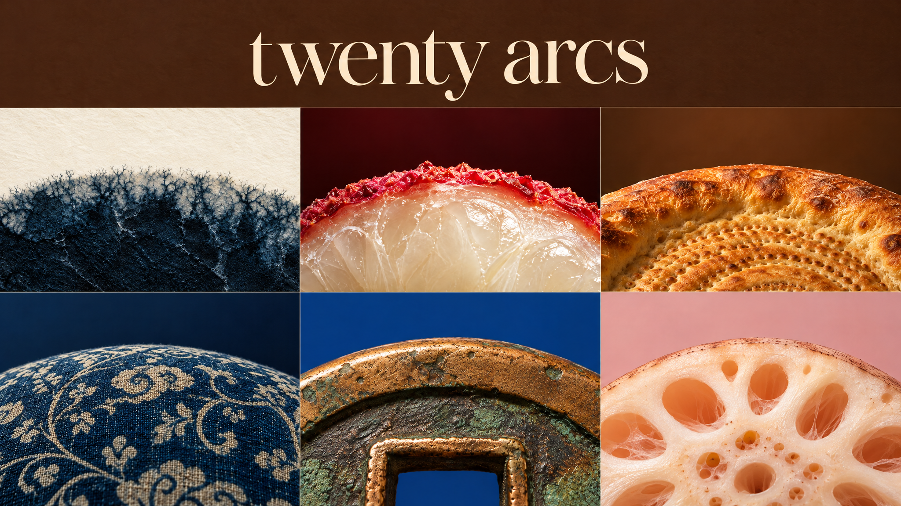
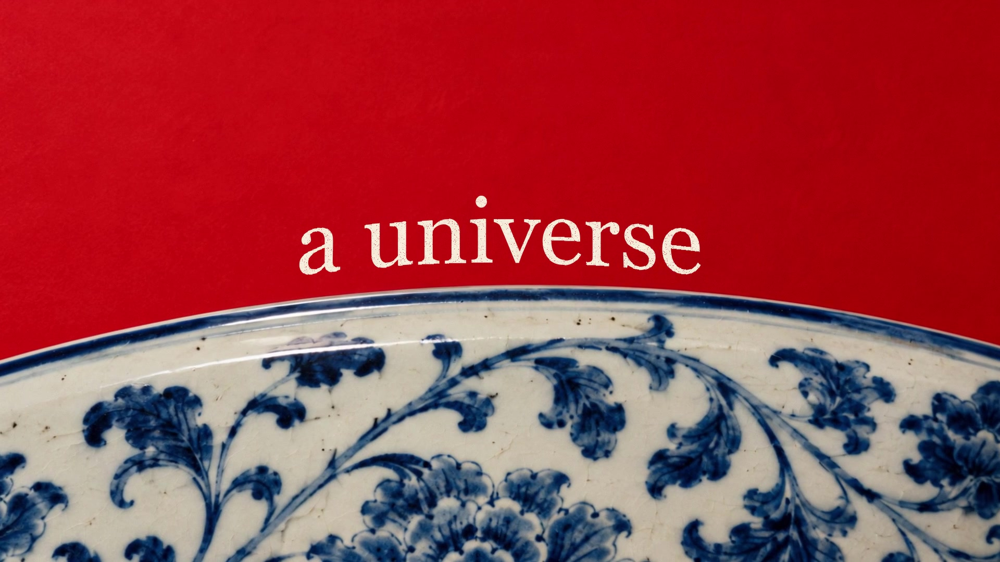

# Circular World Film · 咫尺之间，万象自生

一个面向 AI Agent 的概念片制作 Skill。以圆的边缘为视觉锚点，在统一构图中穿行于不同的材质、尺度与文化；保留原片的复古颗粒、文字质感和逐帧卡点。

## 它能做什么

- 从主题、文化、地域和文案出发，构建 37 个不同的场景，首尾回到同一场景。
- **图片路线**：生成或使用现有图片，以缓慢推近的关键帧自动剪辑。
- **视频路线**：先制作首帧，再使用图生视频模型生成动态镜头，按原片逐帧剪辑。
- 保留 16:9、25 fps、20.08 秒、38 镜的固定节奏，以及分阶段递进的复古文字。
- 默认使用包内原片参考配乐，也可以替换为自己的音乐。

素材和文化可以根据需求变化：例如日本日常与手工艺、某个地区的建筑与植物，或一种材料从微观到宏观的变化。

## 使用

在支持 Skill 的 Agent 中安装完整目录，或让 Agent 读取解压后文件夹内的 `SKILL.md`，保留 `assets`、`references`、`templates` 和 `scripts` 的目录结构。Codex 中可使用 `$circular-world-film`。

> 使用 circular-world-film 制作一支关于【主题／文化／地区】的影片。帮我梳理概念和文案；我选择【图片慢推 / 图生视频】路线，可用的生成工具是【工具或账号】，预算是【预算】。

没有完整概念也可以先填写 压缩包中的 `templates/brief.md`，或让 Agent 提供几个方向。详细说明见 压缩包中的 `USAGE.md`。

## 下载与安装

下载 [完整 Skill 压缩包](circular-world-film-skill.zip)，解压后将其中的 `circular-world-film` 文件夹交给 Agent 安装或读取。不要仅下载根目录的 SKILL.md；运行所需的资源和脚本都在压缩包里。

## 包含

- 原片预览、视觉参考图、原参考配乐与默认文字图层。
- 固定的逐帧时间表、主题简表、37 场景模板和批量提示词脚本。
- 可本地执行的自动剪辑及核验程序；图片和视频生成需要可用的模型、服务或账号。
- GPT Image 2.5 API 适配器，以及其他 API、MCP、CLI 或图形界面工作流的接入说明。

技术要求及命令见 压缩包中的 `references/rendering.md`；服务渠道见 `references/providers.md`。
